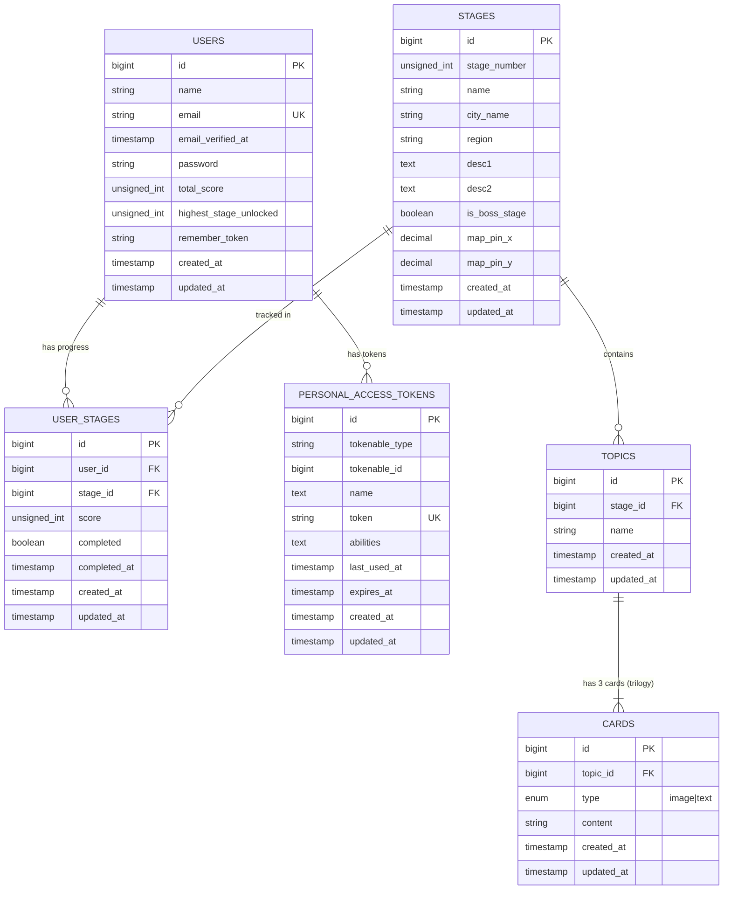

# Trilogi Nusantara

<p align="center">
  
</p>

<p align="center">
  <strong>"Rangkai Fakta, Kenali Bangsa"</strong><br>
  <em>Permainan Memori Edukatif Interaktif Menjelajahi Kekayaan Budaya, Sejarah, Landmark, dan Kuliner Nusantara</em><br><br>
  <strong>Live Demo:</strong> <a href="https://triloginusantara.sgp.dom.my.id" target="_blank">triloginusantara.sgp.dom.my.id</a>
</p>

<p align="center">
  
  
  
  
  
  
</p>

---

## Daftar Isi

- [Tentang Proyek](#tentang-proyek)
- [Fitur Utama](#fitur-utama)
- [Mekanisme Permainan (The Trilogi Concept)](#mekanisme-permainan-the-trilogi-concept)
- [Cakupan Wilayah &amp; Stage](#cakupan-wilayah--stage)
- [Teknologi yang Digunakan (Tech Stack)](#teknologi-yang-digunakan-tech-stack)
- [Arsitektur &amp; Struktur Proyek](#arsitektur--struktur-proyek)
- [Struktur Database](#struktur-database)
- [Dokumentasi API](#dokumentasi-api)
- [Panduan Instalasi &amp; Menjalankan Lokal](#panduan-instalasi--menjalankan-lokal)
- [Tim Pengembang](#tim-pengembang)

---

## Tentang Proyek

**Trilogi Nusantara** adalah aplikasi web game edukasi berbasis memori yang dirancang untuk memperkenalkan dan melestarikan kekayaan budaya, cagar budaya bersejarah, landmark ikonik, serta kuliner khas Indonesia kepada generasi muda.

Trilogi Nusantara mengusung inovasi **Trilogi Match (3-card trio)** dimana pemain harus mencari 3 kartu yang saling berhubungan membentuk satu kesatuan fakta (Gambar Landmark/Objek + Nama Resmi + Fakta/Deskripsi Ciri Khas).

---

## Fitur Utama

- **Mekanika Permainan Trilogi (3-Card Match)**: Mengasah daya ingat visual dan wawasan kognitif pemain secara simultan dengan mencocokkan tiga kartu berkaitan.
- **Peta Interaktif Kepulauan Indonesia**: Dashboard visual peta Nusantara yang membagi perjalanan pemain ke dalam 6 gugus pulau utama.
- **Peta Pin Stage per Pulau**: Setiap pulau memiliki siluet peta resolusi tinggi dengan pin kota/daerah yang presisi berdasarkan persentase koordinat geografis.
- **Deskripsi Budaya & Edukasi Mendalam**: Modal informasi sebelum bermain menampilkan narasi sejarah kota, akulturasi budaya, dan latar belakang tradisi lokal.
- **Timer & Dynamic Scoring System**:
  - Hitung mundur 60 detik per ronde permainan.
  - +10 poin per trilogi yang cocok.
  - Bonus poin berdasarkan sisa waktu saat seluruh kartu berhasil diselesaikan.
  - Rekor skor pribadi: Mengulang stage hanya menambah skor total jika berhasil melampaui rekor skor terbaik sebelumnya (*anti-grinding abuse*).
- **Stage Progression Lock**: Stage terbuka secara berurutan (*sequential unlocking*), mendorong pemain menjelajahi Nusantara dari barat hingga timur.
- **Global Leaderboard**: Menampilkan papan peringkat 50 pemain terbaik dengan total akumulasi skor tertinggi.
- **Dual Auth Flow (Web Session + Sanctum Token)**: Autentikasi fleksibel mendukung Blade server-side rendered form dan SPA asynchronous fetch via localStorage bearer token handoff.
- **Desain Responsif**: Tampilan berestetika modern berbalut motif batik Nusantara yang ramah pengguna di perangkat mobile, tablet, maupun desktop.

---

## Mekanisme Permainan (The Trilogi Concept)

Dalam setiap sesi permainan di sebuah stage:

1. **Seleksi Kartu Acak**: Sistem mengambil 4 topik trilogi (total **12 kartu**) secara acak dari database stage tersebut.
2. **Kategori 3 Kartu per Topik**:
   - **Kartu 1 (Image)**: Foto/visual objek cagar budaya, kuliner, atau pakaian/alat musik daerah.
   - **Kartu 2 (Text - Nama)**: Nama resmi objek (misal: *Lawang Sewu*).
   - **Kartu 3 (Text - Deskripsi/Fakta)**: Fakta kunci atau julukan objek (misal: *Gedung Seribu Pintu*).
3. **Aturan Buka Kartu**:
   - Pemain membuka **3 kartu** berturut-turut.
   - Jika ketiga kartu berasal dari `topic_id` yang sama, kartu dinyatakan **Cocok (Matched)** dan tetap terbuka.
   - Jika ada yang tidak sesuai, kartu otomatis tertutup kembali setelah jeda singkat (*delay 800ms*).
4. **Penyelesaian**: Permainan selesai ketika semua 12 kartu telah berhasil dicocokkan sebelum waktu 60 detik habis.

```
+-------------------------------------------------------------+
|                     TRILOGI MATCHER                         |
|                                                             |
|  [ Kartu Foto ]  +  [ Kartu Nama ]  +  [ Kartu Deskripsi ]  |
|  (lawang-sewu.jpg)  ("Lawang Sewu")   ("Gedung 1000 Pintu") |
|         \                  |                  /             |
|          +--------> TOPIC: LAWANG SEWU <-----+              |
|                     (MATCHED! +10 PTS)                      |
+-------------------------------------------------------------+
```

---

## Cakupan Wilayah & Stage

Proyek ini telah memuat **28 Stage** terdata lengkap di `database/seeders/StageSeeder.php`, mewakili 6 gugus pulau utama:

| Pulau / Wilayah                | Kota / Stage Tersedia                                                           |
| ------------------------------ | ------------------------------------------------------------------------------- |
| **Jawa**                 | Semarang, Jakarta, Bandung, Surabaya, Yogyakarta, Solo, Magelang, Jepara, Kudus |
| **Sumatra**              | Medan, Palembang, Padang, Pekanbaru, Banda Aceh                                 |
| **Bali & Nusa Tenggara** | Bali, NTB (Lombok/Sumbawa), NTT (Flores/Timor)                                  |
| **Kalimantan**           | Balikpapan, Samarinda, Pontianak, Banjarmasin, Palangka Raya                    |
| **Sulawesi**             | Makassar, Manado, Palu                                                          |
| **Papua**                | Jayapura, Sorong, Merauke                                                       |

---

## Teknologi yang Digunakan (Tech Stack)

### Backend

- **Framework**: [Laravel 12.x](https://laravel.com)
- **Language**: PHP >= 8.2
- **Authentication**: [Laravel Sanctum](https://laravel.com/docs/sanctum) (Personal Access Tokens)
- **Database**: MySQL / MariaDB
- **ORM**: Eloquent ORM

### Frontend

- **Templating Engine**: Laravel Blade
- **CSS Framework**: [Tailwind CSS 3.4](https://tailwindcss.com) + PostCSS & Autoprefixer
- **Build Tool**: [Vite 6.x](https://vitejs.dev) via `laravel-vite-plugin`
- **Client Scripting**: Vanilla JavaScript (ES6+ modular, Fetch API, HTML5 Web Storage)
- **Icons & Typography**: Google Fonts (Inter), inline SVG Nusantara elements

---

## Arsitektur & Struktur Proyek

```
trilogi/
├── app/
│   ├── Http/
│   │   └── Controllers/
│   │       ├── AuthController.php          # REST API auth (login, register, logout, me)
│   │       ├── WebAuthController.php       # Web UI auth controller & handoff
│   │       ├── GameIslandController.php    # Logika peta pulau & kalkulasi pin stage
│   │       ├── LeaderboardController.php   # Global leaderboard API
│   │       ├── ProgressController.php      # Sinkronisasi progres & rekor skor
│   │       └── StageController.php         # Endpoint stage & kartu permainan
│   ├── Models/
│   │   ├── User.php                        # Model pemain, skor total, stage unlock
│   │   ├── Stage.php                       # Model stage/kota, koordinat pin, deskripsi
│   │   ├── Topic.php                       # Model topik trilogi dalam stage
│   │   ├── Card.php                        # Model kartu (image / text)
│   │   └── UserStage.php                   # Pivot progres user & rekor per stage
│   └── Support/
│       └── StageUnlock.php                 # Helper validasi stage unlock berurutan
├── config/                                 # Konfigurasi aplikasi Laravel
├── database/
│   ├── migrations/                         # Skema database & tabel
│   └── seeders/
│       ├── DatabaseSeeder.php
│       └── StageSeeder.php                 # Database 28 stage, ratusan topik & kartu
├── public/
│   ├── css/                                # Custom styling (game.css, common.css)
│   ├── images/
│   │   ├── cards/                          # Aset foto kartu budaya/landmark
│   │   └── islands/                        # Siluet peta pulau (sumatra.png, jawa.png, dll)
│   └── js/                                 # Script modular (auth.js, game.js, island-stages.js)
├── resources/
│   ├── css/                                # Tailwind input css
│   ├── js/                                 # Vite JS bundle
│   └── views/
│       ├── landing.blade.php               # Halaman utama / landing page
│       ├── login.blade.php                 # Form masuk
│       ├── register.blade.php              # Form pendaftaran
│       ├── auth-handoff.blade.php          # Jembatan token web -> localStorage
│       ├── game.blade.php                  # Dashboard Pilih Pulau (Peta Nusantara)
│       ├── island-stages.blade.php         # Peta interaktif Pilih Stage per Pulau
│       └── memory-game.blade.php           # Arena permainan kartu memori (/play)
├── routes/
│   ├── api.php                             # Rute RESTful API (Sanctum protected)
│   └── web.php                             # Rute tampilan web Blade
└── vite.config.js                          # Konfigurasi bundler Vite
```

---

## Struktur Database



### Penjelasan Entitas Database

| Nama Tabel                 | Deskripsi                                                                                                                                             | Relasi & Constraint                                                                                                        |
| -------------------------- | ----------------------------------------------------------------------------------------------------------------------------------------------------- | -------------------------------------------------------------------------------------------------------------------------- |
| `users`                  | Menyimpan kredensial pemain, akumulasi `total_score`, dan stage tertinggi yang terbuka (`highest_stage_unlocked`).                                | Relasi 1-to-many ke `user_stages` dan `personal_access_tokens`. Kolom `email` bersifat unik (`UK`).                |
| `stages`                 | Menyimpan data 28 stage/kota di Indonesia, narasi edukasi (`desc1`, `desc2`), serta persentase koordinat pin peta (`map_pin_x`, `map_pin_y`). | Relasi 1-to-many ke `topics` dan `user_stages`. Diurutkan via `stage_number`.                                        |
| `topics`                 | Topik budaya atau cagar budaya spesifik dalam satu stage (misal: "Landmark & Sejarah (Lawang Sewu)").                                                 | Foreign key `stage_id` mengarah ke `stages.id` (`cascadeOnDelete`). Relasi 1-to-many ke `cards`.                   |
| `cards`                  | Menyimpan kartu individu pembentuk trilogi per topik (1 kartu foto `image` dan 2 kartu nama/fakta `text`).                                        | Foreign key `topic_id` mengarah ke `topics.id` (`cascadeOnDelete`). Kolom `type` bernilai `image` atau `text`. |
| `user_stages`            | Mencatat riwayat dan status penyelesaian stage tiap pemain beserta rekor `score` terbaiknya.                                                        | Foreign key `user_id` dan `stage_id` (`cascadeOnDelete`) dengan unique constraint kombinasi `[user_id, stage_id]`. |
| `personal_access_tokens` | Mengelola token autentikasi API via Laravel Sanctum untuk sesi login pemain.                                                                          | Polymorphic relation `tokenable` ke model `users`.                                                                     |

---

## Dokumentasi API

### 1. Autentikasi & Akun

| Method   | Endpoint        | Auth         | Deskripsi                                           |
| -------- | --------------- | ------------ | --------------------------------------------------- |
| `POST` | `/api/auth`   | Publik       | Login atau Register otomatis via email + kata sandi |
| `GET`  | `/api/me`     | Bearer Token | Ambil profil user yang sedang aktif                 |
| `POST` | `/api/logout` | Bearer Token | Cabut token aktif saat ini                          |

### 2. Stage & Kartu

| Method  | Endpoint                   | Auth            | Deskripsi                                                               |
| ------- | -------------------------- | --------------- | ----------------------------------------------------------------------- |
| `GET` | `/api/stages`            | Publik          | Mendapatkan seluruh daftar stage dan region                             |
| `GET` | `/api/stages/{id}/cards` | Opsional/Bearer | Mengambil kartu untuk stage terpilih (memeriksa izin unlock jika login) |

### 3. Progres & Leaderboard

| Method   | Endpoint                   | Auth         | Deskripsi                                                            |
| -------- | -------------------------- | ------------ | -------------------------------------------------------------------- |
| `GET`  | `/api/progress`          | Bearer Token | Mengambil detail stage yang telah diselesaikan user                  |
| `POST` | `/api/progress/complete` | Bearer Token | Menyimpan penyelesaian stage, update skor, & unlock stage berikutnya |
| `GET`  | `/api/leaderboard`       | Publik       | Top 50 pemain berdasarkan akumulasi `total_score`                  |

---

## Panduan Instalasi & Menjalankan Lokal

Ikuti langkah-langkah di bawah ini untuk menjalankan Trilogi Nusantara di komputer lokal Anda:

### 1. Prasyarat Sistem

Pastikan lingkungan Anda telah terpasang:

- **PHP** >= 8.2 (ekstensi: `pdo`, `pdo_mysql` / `pdo_sqlite`, `mbstring`, `openssl`, `curl`)
- **Composer** (v2.x)
- **Node.js** (v18.x atau v20.x+) & **NPM**
- **MySQL / MariaDB**
- **Git**

### 2. Clone Repositori

```bash
git clone https://github.com/vinhartz06/trilogi.git
cd trilogi
```

### 3. Install Dependensi PHP & Node.js

```bash
# Install PHP dependencies
composer install

# Install Node dependencies
npm install
```

### 4. Konfigurasi Environment File

Salin file `.env.example` menjadi `.env`:

```bash
# Windows PowerShell / CMD:
copy .env.example .env

# Linux / macOS:
cp .env.example .env
```

Generate application key:

```bash
php artisan key:generate
```

### 5. Konfigurasi Database

Buka file `.env`, sesuaikan pengaturan koneksi database Anda:

**Menggunakan MySQL**

```env
DB_CONNECTION=mysql
DB_HOST=127.0.0.1
DB_PORT=3306
DB_DATABASE=trilogi
DB_USERNAME=root
DB_PASSWORD=password_kamu
```

### 6. Jalankan Migrasi & Seeder Konten

Jalankan migrasi tabel beserta pengisian data 28 stage dan ratusan kartu budaya:

```bash
php artisan migrate --seed
```

### 7. Jalankan Aplikasi

Buka dua jendela terminal untuk menjalankan asset compiler dan web server:

**Terminal 1 (Vite Asset Dev Server):**

```bash
npm run dev
```

**Terminal 2 (Laravel Artisan Server):**

```bash
php artisan serve
```

Aplikasi dapat diakses melalui browser di: `http://127.0.0.1:8000` atau `http://localhost:8000`

> *Anda juga bisa menjalankan `npm run build` terlebih dahulu untuk mengompilasi aset frontend. Dengan begitu, Anda cukup menjalankan satu terminal saja (`php artisan serve`) tanpa perlu menjalankan `npm run dev`.*

---

## Tim Pengembang

Proyek ini dikembangkan oleh mahasiswa **Teknik Informatika Soegijapranata Catholic University**

| Pengembang                 | Role      | Media Sosial                                                                                                                                                                                                                                                                               |
| -------------------------- | --------- | ------------------------------------------------------------------------------------------------------------------------------------------------------------------------------------------------------------------------------------------------------------------------------------------ |
| **Jonathan Vincent** | Developer | [](https://instagram.com/j.vincent2006) [](https://github.com/vinhartz06) |
| **Claudio Raditya**  | Developer | [](https://instagram.com/cradityabp) [](https://github.com/pamungkas06)     |
